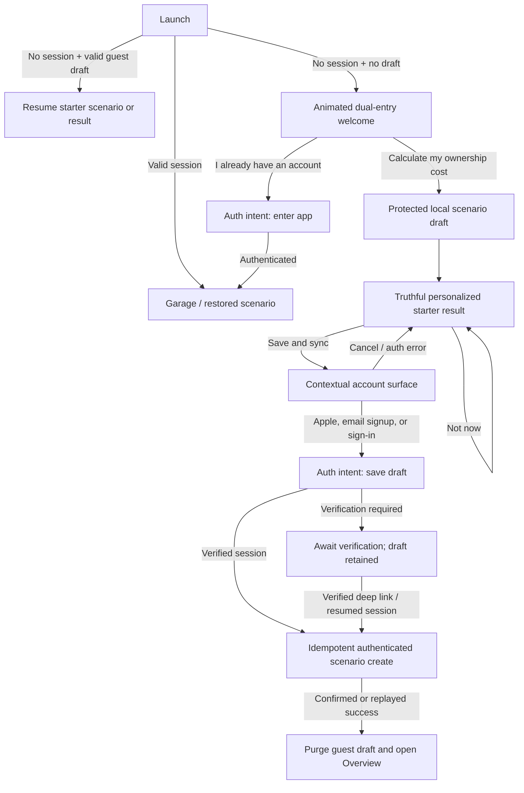

# Value-First Onboarding and Deferred Account Capture

Canonical tasks: [ONB-100 through ONB-105](https://github.com/kudg0/assets-invest-comparator/blob/main/docs/product-work-plan.md#onb-100--program-value-first-first-run-and-deferred-account-capture)

The canonical status, dependencies, priority, and acceptance criteria live in
the backend repository's `docs/product-work-plan.md`. This document is the
focused product, motion, state, privacy, and handoff specification. It must not
become a second backlog.

## Decision summary

Worth It will replace its login-first first run with a dual-entry, value-first
journey:

- A new person chooses `Calculate my ownership cost`, creates one protected
  local draft, and sees a truthful personalized starter result before being
  asked to authenticate.
- A returning person can choose `I already have an account` from the first
  viewport and enter the existing authentication journey directly.
- Account creation/sign-in appears contextually when the person chooses `Save
  and sync`. It preserves the result behind the account surface and explains
  the concrete exchange: persistent history, backup, synchronization, and
  access on another device.
- Canceling authentication, entering an incorrect password, losing the network,
  following an email-verification link, or killing the app never destroys the
  guest draft.
- The backend never creates anonymous users or anonymous scenario rows. After a
  verified session exists, the normal authenticated scenario create owns the
  data and is made retry-safe with the draft's idempotency key.

The account prompt must not appear before the first meaningful result. Making a
person complete a long form and then withholding every result until signup is a
sunk-cost trap, not value-first onboarding.

## Evidence and its limits

Apple's current guidance is unusually direct:

- [Managing accounts](https://developer.apple.com/design/human-interface-guidelines/managing-accounts)
  says to ask for an account only when core functionality needs it and to delay
  sign-in long enough for people to understand the product.
- [Onboarding](https://developer.apple.com/design/human-interface-guidelines/onboarding)
  recommends a fast, optional, interactive experience and postponing
  nonessential setup.
- [Sign in with Apple](https://developer.apple.com/design/human-interface-guidelines/sign-in-with-apple)
  says to ask for sign-in in exchange for value and delay it where possible.
- [App Review Guidelines 5.1.1(v)](https://developer.apple.com/app-store/review/guidelines/)
  require non-account-based functionality to remain usable without login and
  require in-app account deletion when the app creates accounts.

Duolingo is useful as an experiment pattern, not a visual template:

- Its [official learning guide](https://blog.duolingo.com/duolingo-101-how-to-learn-a-language-on-duolingo/)
  describes initial choices and learning before creating a profile to save
  progress.
- Its [current entry](https://www.duolingo.com/learn) exposes both a new-user
  start and an existing-account path.
  Recorded iOS variants also put product interaction and a first lesson before
  profile creation, but Duolingo continuously experiments, so no one recording
  is a permanent universal flow.
- In a 2017 [First Round interview](https://review.firstround.com/the-tenets-of-a-b-testing-from-duolingos-master-growth-hacker/),
  Duolingo's then growth leader reported that moving signup later produced
  roughly a 20% DAU increase, followed later by an 8.2% DAU increase from
  refining soft and hard walls.
- Those are historical company-reported results without raw data, sample size,
  or confidence intervals. DAU is not Worth It's activation metric. The figures
  justify testing the hypothesis; they are not a forecast or roadmap promise.
- Duolingo's own [experimentation write-up](https://blog.duolingo.com/improving-duolingo-one-experiment-at-a-time/)
  is the more important lesson: ship by controlled evidence, monitor retention
  guardrails, and reject a local conversion win that hurts the product.

Do not copy Duolingo's mascot, game tone, streak pressure, confirmshaming, or
visual language. Worth It keeps its dark automotive analytics identity.

### Review of the UXPeak psychology video

The complete 11:34 transcript of
[The UX Psychology Behind Apps People Can't Stop Using](https://www.youtube.com/watch?v=2TlIg3VokY8),
published by UXPeak on 2026-07-02, was reviewed. It is an educational marketing
video, not a research report: it provides no methods, samples, confidence
intervals, or source list and contains two commercial segments. Its patterns
are hypotheses until supported by primary evidence and Worth It research.

| Time | Video claim | Evidence verdict | Worth It rule |
| --- | --- | --- | --- |
| 00:28-01:46 | Empty forms and many choices cause abandonment; 70-90% of people keep defaults. | The original [jam study](https://business.columbia.edu/faculty/research/when-choice-demotivating-can-one-desire-too-much-good-thing) reported 30% versus 3% purchase for six versus 24 options, but a later [choice-overload meta-analysis](https://doi.org/10.1086/651235) found a near-zero mean with substantial variation. A [defaults meta-analysis](https://www.cambridge.org/core/journals/behavioural-public-policy/article/when-and-why-defaults-influence-decisions-a-metaanalysis-of-default-effects/67AF6972CFB52698A60B6BD94B70C2C0) supports a contextual default effect, not the video's universal 70-90% claim. | Reduce simultaneous decisions. Default only from known device/account data, prior choices, or measured evidence. Record provenance, keep editing easy, and require review for material financial assumptions. Never default consent. |
| 01:46-03:08 | Start onboarding at an artificial 20% to create momentum. | The [endowed-progress study](https://doi.org/10.1086/500480) found 34% versus 19% reward completion in one car-wash loyalty context. The video misattributes the researchers to Columbia and turns a bounded result into a universal rule. | Count only real completed actions. Do not award progress for viewing Welcome or draw a fake 20%. Use named steps for branching flows; use a percentage only when its denominator is stable and truthful. |
| 03:52-05:36 | Give value before signup because reciprocity drives a large conversion lift. | Value-first is consistent with Apple guidance and Duolingo's delayed-signup report, but the video's `massive` conversion and free-sample figures are unsupported. Reciprocity does not justify creating psychological debt. | Reveal a standalone useful personalized result before auth. Do not blur or hold the core answer hostage. Ask for account only through the explicit value of Save and sync. |
| 05:36-07:04 | User labor and ownership make abandonment harder; Duolingo captures this before signup. | The [IKEA-effect paper](https://doi.org/10.1016/j.jcps.2011.08.002) found that labor increased valuation only after successful completion. Applying ownership of a physical object to a financial draft is still a product hypothesis. Duolingo's exact claimed ten-minute duration is unverified and its flow varies. | Reach successful calculation quickly. Every field must improve the result or routing; never add work to manufacture sunk cost. Persist the draft, but never threaten the user with losing it. |
| 08:20-09:37 | Losses are universally twice as strong; countdowns and `I'll risk it` make users act. | The exact two-times claim is context-dependent and disputed; `threat wins every time` is unsupported. The [FTC dark-pattern report](https://www.ftc.gov/reports/bringing-dark-patterns-light) identifies false urgency, hidden information, and coercive hierarchy as harmful patterns. | Reject this implementation. Use neutral `Not now`, equal access to escape, and factual consequences only. A real expiry may be explained calmly; it must not become an invented countdown or shame message. |
| 09:37-11:03 | A preceding high number makes the next cost feel small. | Anchoring and contrast are real contextual effects, but the video's laptop, restaurant, and real-estate examples are illustrations rather than reported tests. | Use comparison context to improve understanding, never to steer with a decoy. Compare the same horizon, currency, tax basis, coverage, and unit. Show absolute value, per-period/per-distance value, and assumptions together. |
| 11:03-11:34 | Even fake progress creates useful momentum. | This contradicts the video's own written warning not to fake progress or results. | Fake progress is prohibited. A conversion gain cannot override truthfulness, accessibility, privacy, or decision quality. |

The useful synthesis is not `people are irrational, so exploit biases`. Worth It
is financial decision support. Its job is to make a hard decision legible while
preserving informed choice.

### Duolingo practices worth transferring

- Transfer value timing, not screen count. Duolingo's official guide frames a
  profile as the way to save progress and use another device after initial
  learning choices. Worth It uses one honest prompt after a real result, not
  several soft walls followed by an artificial hard wall.
- Transfer experiment discipline. Duolingo defines a hypothesis, arms,
  eligibility and expected results, rolls out gradually, and has rejected a
  monetization win when retention fell in its
  [experimentation case study](https://blog.duolingo.com/improving-duolingo-one-experiment-at-a-time/).
- Measure lifecycle transitions rather than one top-line conversion. Duolingo's
  [Growth Model](https://blog.duolingo.com/growth-model-duolingo/) separates
  new, current, at-risk, reactivated and resurrected states. Worth It needs
  `first open -> draft -> personalized result -> auth -> committed scenario ->
  D1/D7`, with returning users and expired sessions outside the new-user cohort.
- Optimize quality, not activity volume. Duolingo replaced a session-count
  metric that rewarded easy grinding with
  [Time Spent Learning Well](https://blog.duolingo.com/time-spent-learning-well/).
  Worth It's analogous activation is a valid explainable result followed by a
  server-confirmed scenario, not screens completed or time spent in onboarding.
- Treat localization as research. Duolingo found that changing intimidating
  placement-test wording doubled starts and increased retention, then tested
  the insight globally in its
  [Asia product research](https://blog.duolingo.com/lessons-from-asia-turning-local-research-into-global-experiments/).
  Worth It must comprehension-test `scenario`, `ownership cost`, `estimate`,
  `Save and sync`, and financial assumptions in EN/RU and each enabled locale.
- Put expressive feedback at the successful action. Duolingo places character
  animation after correct work in its
  [character design write-up](https://blog.duolingo.com/building-character/).
  For Worth It, Welcome motion remains a nonblocking teaser; the personalized
  result reveal is the earned payoff. This is a design hypothesis, not published
  evidence that animation itself improves activation.
- Protect performance as a product metric. Duolingo uses successful app open as
  a cross-experiment guardrail in its
  [performance case study](https://blog.duolingo.com/android-app-performance/).
  Worth It records time-to-interactive and time-to-result distributions; motion
  cannot delay either CTA, first input, or result legibility.

Do not transfer daily streaks, mascot pressure, repeated registration prompts,
XP grinding, or Duolingo's DAU target. Worth It has lower-frequency, financially
sensitive decisions and must earn trust differently.

### Agent review gate for behavioral UX

Before approving a behavioral onboarding change, answer all of these:

1. What real user problem or cognitive cost does it reduce?
2. Does each requested input change calculation, routing, legal handling, or a
   signed experiment? If not, remove it.
3. Where did each default come from, how is provenance shown, and can it be
   corrected without penalty?
4. Does every progress unit correspond to completed work with a truthful total?
5. Is the pre-auth result independently useful when the person chooses `Not
   now`?
6. Are decline/back paths neutral, visible, and free of loss threats or false
   hierarchy?
7. Are every comparison baseline, unit, window, source and assumption
   traceable?
8. Is this one falsifiable hypothesis with eligibility, exposure, primary
   outcome, guardrails, sample/power rule, and rollback? If traffic is too low,
   use usability research and an instrumented staged rollout; do not announce an
   A/B winner.

## Audited current truth

- `RootView` is a binary auth switch. Without a session it renders only
  `AuthFlowView`; `CreateScenarioFlowView` exists only inside the authenticated
  shell.
- `AuthEntryScreen` presents Apple, email sign-in, and account creation before
  any product action. Its `CockpitCluster` is a static native SwiftUI
  composition, not a raster image.
- The create-scenario fields live only in view-local `@State`. Destroying the
  view, replacing the auth branch, or killing the app destroys the draft.
- The final create action immediately calls protected `POST /scenarios`.
- The backend correctly derives `userId` from the authenticated session and
  exposes no anonymous product writes. Preserve this boundary.
- `HTTPAPIClient` currently broadcasts the same global unauthorized event for
  every 401. A contextual sign-in's invalid-credentials response must not be
  mistaken for expiry of an existing app session or reset onboarding state.
- There is no guest-draft store, deferred authenticated action, product-funnel
  event abstraction, experiment assignment, or UI-test target.
- The current create flow starts with a car-versus-disabled-Other-Assets screen.
  SCOPE-001 already owns removing that misleading branch; onboarding reuses the
  car-only outcome rather than duplicating it.

## Target journey



### Root coordinator states

The root must stop deriving the complete experience from one Boolean. Introduce
an explicit coordinator above both the app and auth navigation stacks:

```text
launching
welcome
guestEditing(draftID, step)
guestResult(draftID, previewVersion)
authenticating(intent: enterApp | saveScenario(draftID))
awaitingVerification(draftID)
readyToPersist(draftID, userID)
persisting(draftID, idempotencyKey)
authenticated
```

Only a confirmed authenticated create can transition the pending draft to
committed and delete the local file.

## Screen and interaction contract

### 1. Animated dual-entry welcome

Hierarchy:

1. Worth It wordmark.
2. One concise promise, such as `Know what your car really costs.`
3. A purposeful product animation described below.
4. Primary action: `Calculate my ownership cost`.
5. Secondary action: `I already have an account`.
6. Transparent expectation: `Try a calculation without an account. Sign in
   when you want to save and sync.`

Do not place Apple, email sign-in, and Create Account as three competing actions
on this first screen. They belong in the returning-user auth route and the
contextual save surface. Both primary and returning-user actions remain visible
without waiting for animation and without scrolling on a normally sized phone.

### 2. Starter scenario

- Start directly with a car. Do not repeat the disabled asset-type choice.
- Aim for a focused 60-120 second path, but sign the field list from usability
  evidence rather than optimizing an arbitrary screen count.
- Ask only what the selected starter result needs. Derive region, currency,
  unit, and timezone defaults from the device while keeping them reviewable.
- Use progressive disclosure for financing and other conditional fields.
- Do not request email, name, notifications, tracking permission, location,
  photos, VIN, or attachments in this flow.
- Explain why a financially sensitive field is needed next to the field.
- Autosave each valid change to the protected draft store. Back and app relaunch
  resume the same step.

### 3. First-value result

Preferred result contract:

- estimated ownership cost per month;
- estimated cost per km/mile;
- largest contributing cost driver;
- assumptions, coverage, and an `estimate` label.

ONB-101 must prove these values are calculable from the signed starter inputs.
If they require annual distance, holding period, or recurring-cost assumptions,
collect and version those assumptions explicitly. Never reuse the welcome's
example values as if they were personalized. If the preferred result cannot be
made truthful in the first slice, ship a narrower truthful financing/
depreciation baseline rather than inventing precision.

The result appears before auth. It remains visible behind or immediately above
the contextual save surface so the account request does not erase context. The
complete signed starter result remains readable and useful without signup; do
not blur the core values or hide essential assumptions behind the account
surface.

### 4. Contextual save and account surface

Title the action by value, not by internal auth mechanics: `Save and sync this
scenario`.

- Explain benefits briefly: keep tracking history, restore it, and use another
  device.
- Show Sign in with Apple as a primary method only when its capability and
  backend provider are actually enabled. Never keep a fake button visible.
- Offer email account creation and a clear existing-account sign-in switch.
- Keep `Not now`/Back visible; it returns to the result and retains the local
  draft.
- Display privacy/terms links without turning them into dense onboarding copy.
- Do not use countdowns, loss wording, `Discard progress`, or a visually hidden
  escape.

### 5. Returning-user auth

The first welcome viewport always exposes the returning-user route. It reuses
AUTH-owned Apple/email/recovery/security behavior, then opens the existing
Garage. It does not create or attach a guest scenario unless the explicit auth
intent is `saveScenario`.

An expired session inside the authenticated app goes to contextual reauth, not
the new-user welcome. Preserve the interrupted operation under its owning task.

## Motion specification

The current native `CockpitCluster` is the starting component. Do not add a
remote video, autoplay audio, Lottie/Rive runtime, or a mascot merely to make
the screen move.

Storyboard for one 4-6 second nonblocking sequence:

1. The ignition/analysis ring wakes with a short opacity/stroke reveal.
2. Cost and distance signals enter the calculation plane.
3. The ring resolves them into monthly cost and cost-per-distance.
4. An alternative path appears and the useful result receives one restrained
   gold/danger emphasis.
5. The composition settles into a calm static final state instead of looping
   continuously.

Rules:

- Motion demonstrates the product model; it is not a launch screen or loading
  gate. The CTA is interactive from frame one and no task waits for completion.
- Example numbers are explicitly labelled as examples. Do not imply route
  tracking, live vehicle data, or other unshipped behavior.
- Prefer native SwiftUI phase/keyframe animation and existing DS shapes. Add a
  third-party runtime only after a measured prototype proves a need and the
  dependency/privacy/bundle review is signed.
- Pause when off-screen, scene-inactive, or backgrounded. Do not leave a
  continuous `TimelineView` consuming resources.
- `accessibilityReduceMotion` shows the fully understandable final state or a
  brief dissolve. Low Power Mode also uses the settled state.
- VoiceOver reads one localized semantic summary and ignores decorative layers.
  Motion is never the only carrier of meaning.
- Use responsive layout rather than fixed Spacers so the headline, animation,
  and two actions survive the smallest supported phone, landscape if supported,
  and accessibility Dynamic Type.
- Prototype the welcome, starter result, account surface, and reduced-motion
  state in the canonical Worth It Stitch project before production SwiftUI.

The Welcome sequence is a teaser, not the only payoff. When the real preview
succeeds, the result may use one restrained action-triggered resolve into the
personalized values. It must never display completion while the request is
pending, conceal the numbers, or delay legibility. Welcome and result motion
have separate flags/exposure IDs, and each has an equivalent static state.

Apple's [Motion](https://developer.apple.com/design/human-interface-guidelines/motion)
guidance requires purposeful, optional, cancellable motion. Its
[Launching](https://developer.apple.com/design/human-interface-guidelines/launching/)
guidance keeps artistic animation out of the system launch screen, and its
[Accessibility](https://developer.apple.com/design/human-interface-guidelines/accessibility/)
guidance requires a reduced-motion alternative.

## Guest draft data contract

V1 supports one active guest draft.

```text
GuestScenarioDraft
  schemaVersion
  localDraftID: UUID
  createdAt / updatedAt / expiresAt
  currentStep
  explicitFields + defaultProvenance
  region / currency / unit / timezone
  starterScenarioValues
  previewRequestVersion / previewResultVersion
  authIntentState
  boundUserID? / persistenceGeneration?
```

Storage rules:

- Store one atomically replaced Codable file in Application Support with iOS
  complete file protection; exclude it from device/cloud backups. Do not put
  financial values in `UserDefaults` or auth Keychain records.
- Use a 30-day inactivity TTL for the launch experiment. Show Resume and Start
  Over, update the TTL on a meaningful edit, and make destructive discard
  explicit. PRIVACY-001 can tighten the signed value before release.
- Version and test schema migration. If an old draft cannot be migrated, explain
  the incompatibility and offer explicit discard; never crash or silently
  reinterpret money/unit/date values.
- Record whether a default was inferred or explicitly chosen. When attaching to
  an existing account, explicit guest choices win. For unset values, apply
  PROF-002 account defaults. A material currency/unit/region conflict requires
  review rather than silent conversion.
- Never store passwords, session/provider tokens, email-verification payloads,
  raw auth errors, or a complete auth response beside the draft.
- Purge only after server-confirmed/replayed scenario creation, explicit Start
  Over, expiry, or app deletion. Cancel/auth failure leaves it intact.
- Never copy authenticated server scenarios into guest storage on logout.

## Preview backend contract

Use a stateless public preview endpoint backed by the same versioned domain
calculation service as authenticated analytics:

```text
POST /onboarding/scenario-preview
```

The final path is published through CONTRACT-002. Security contract:

- No Prisma call, anonymous user, cookie, server draft, or durable request body.
- Accept only the minimal bounded numeric/enum/date assumptions needed for the
  signed result. Exclude vehicle name, notes, email, location, identifiers,
  photos, attachments, and auth material.
- Apply SEC-001 strict DTOs, body/number/date limits, an unauthenticated route
  budget, rate limiting, generic 413/422/429/5xx errors, and injection/log tests.
- Never log payload values. Telemetry can record result class, model version,
  latency, validation category, and experiment arm only.
- Return `Cache-Control: no-store`, model/assumption version, coverage/confidence,
  basis rows, and the limited starter result.
- If offline, retain the draft and show a retryable state. Do not substitute a
  fake personalized answer.

This endpoint is a deliberate exception to the backend's product-route auth
guard. SEC-001 must verify that it cannot write, enumerate accounts, perform
unbounded calculation, or become a database/query bypass.

## Auth continuation and scenario commit

Introduce an explicit `AuthIntent`:

```text
enterApp
saveScenario(localDraftID)
```

The coordinator, not an individual auth screen, owns the continuation.

1. Starting contextual auth records only the intent/draft ID and leaves the
   protected draft in place.
2. Apple cancellation, invalid credentials, AUTH-003 cooldown, recovery, or
   provider failure returns to the account surface/result without mutation.
3. Successful signup/sign-in/verification establishes the normal session.
4. The mapper revalidates the current draft, applies signed default precedence,
   and sends authenticated `POST /scenarios`.
5. The stable local draft UUID is the Idempotency-Key for this logical create.
   IDEMP-001 must include Scenario creation. A lost response replays the same
   scenario ID rather than creating a duplicate.
6. The backend still ignores any client owner/user ID and derives ownership from
   the verified session.
7. The draft is deleted only after confirmed/replayed success, then the app opens
   that scenario's Overview.

Fix global 401 semantics before integration: only a response to a request that
carried the current app session and proves that session invalid may publish the
global session-expiry signal. A 401 from sign-in, recovery, preview, stale guest
work, or another unauthenticated request is a local typed error and cannot clear
the session store, root path, or guest draft.

Account switching requires intent:

- On first successful auth, bind the pending commit generation to that user.
- If a different user authenticates before commit, explain that the local draft
  is about to be saved to the current account and require confirmation.
- If commit outcome is ambiguous, resolve/replay under the originally bound
  session before offering a move. Never silently duplicate the same draft into
  two accounts.

AUTH-000/001 own verification and session policy; AUTH-002/MAIL-001 own recovery
and email-link behavior; AUTH-003 owns cooldown; AUTH-004/005 own password input
and migration; APPLE-001 owns the production Apple provider. This onboarding
program consumes those paths without reimplementing them.

## Failure and recovery matrix

| Event | Required outcome |
| --- | --- |
| Apple sheet canceled | Return to result/account surface; draft unchanged |
| Invalid email password | Inline typed error; no global unauthorized reset |
| Account already exists during signup | Offer sign-in; retain form and draft |
| Verification link required | Persist awaiting-verification intent and resume after deep link/relaunch |
| Offline during form | Continue editing/autosaving locally; preview/save are retryable |
| Preview 413/422/429/5xx | Explain retry/correction; no draft loss or fake result |
| Auth succeeds, create fails | Stay authenticated, retain draft, expose Retry |
| Create commits, response is lost | Idempotent retry returns the committed scenario |
| App killed at any precommit state | Restore exact draft step/result/auth intent safely |
| Draft schema changed | Migrate or ask to discard; never silently reinterpret |
| User switches accounts | Explicit target-account confirmation; no cross-account leak/duplicate |
| Draft expires | Purge locally and explain on next open without claiming server deletion |
| Session expires in authenticated app | Contextual reauth; do not show first-run welcome |

## Privacy and security

- The welcome promise must not say `nothing leaves this device`, because the
  stateless preview sends a minimal request to the service. Say what is true:
  no account is needed for the calculation and the scenario is not stored in
  the account until Save succeeds.
- Update privacy disclosures for the anonymous preview and onboarding event
  transport, including purpose and retention.
- Do not collect IDFA, fingerprint the device, attach ad identifiers, or put
  vehicle name, price, loan values, exact dates, email, IP-derived location,
  password, or tokens in product events.
- The install experiment ID is random, app-scoped, non-advertising, and expires
  according to the signed analytics retention policy.
- Rate limits/WAF are defense in depth. Strict validation, bounded calculation,
  no persistence, redaction, and least privilege remain authoritative.
- Guest draft deletion is separate from account deletion. Account deletion must
  not leave an attached local guest copy, and clearing a guest draft must not
  claim to delete server data.

## Measurement and experiment contract

Do not combine journey, copy/default/progress, Welcome motion, and result-reveal
motion into one causal test.

Experiment A — journey:

- Control: current auth-first entry.
- Treatment: dual-entry, starter scenario, personalized result, auth at Save.
- Eligible population: fresh unauthenticated installs only. Returning users,
  deep links, expired sessions, QA, and migrations are separate cohorts.

Experiment B — copy/default/progress after the journey is usable:

- Test one named treatment at a time, such as named steps versus no progress or
  one reviewed default versus explicit choice.
- Never include a prohibited dark pattern as an experiment arm. An experiment
  cannot make deception acceptable.

Experiment C — presentation after the journey is stable:

- Control: accessible settled hero.
- Treatment: purposeful one-shot product animation.
- Test Welcome motion and personalized result-reveal motion separately; do not
  switch both in one treatment.

Primary activation metric:

- eligible first launches with one server-confirmed first scenario within 24
  hours.

Required precursor:

- one valid personalized preview rendered before auth.

Secondary metrics:

- starter draft start and valid completion;
- first personalized result viewed;
- p50/p95 time to first interaction and personalized result;
- account surface view, auth start, auth success by method;
- draft commit success/replay/failure;
- D1/D7 return and first core log action.

Guardrails:

- draft-loss/recovery rate;
- duplicate scenarios/accounts and wrong-account attachment;
- returning-user auth completion;
- auth cancellation/recovery availability;
- preview/auth latency and error rate;
- comprehension/trust checks by enabled locale;
- crash-free sessions, accessibility completion, performance/energy, and
  support/privacy reports.

Event properties are closed enums, duration buckets, versions, and outcomes.
They never contain financial values, free text, dates, emails, vehicle data, or
auth secrets. Add a typed `ProductAnalytics` protocol with no-op and recording
test implementations; choose/approve the production EU/consent/retention
transport in ONB-101 before emitting network events.

Pre-register eligibility, assignment, primary metric, guardrails, minimum
detectable effect, sample size, and stop conditions. Use a stable local variant
assignment behind a remote kill switch. Do not claim a win from raw signup
conversion, a partial funnel, repeated peeking, or Duolingo's historical uplift.
If traffic cannot power the signed comparison, use usability research and an
instrumented staged cohort with predetermined safety/rollout rules. Report it as
descriptive evidence, not an A/B winner.

## Verification matrix

- Fresh install, valid session, expired session, pending guest draft, pending
  verification, and committed replay launch states.
- Every form step through kill/relaunch, background/foreground, offline/online,
  locale/unit/currency/timezone changes, and draft schema migration.
- Apple signup/sign-in/cancel/provider failure; email signup/sign-in/invalid
  password/account exists/recovery/verification deep link.
- Preview request bounds, no-write proof, rate limits, log redaction, and service
  parity with authenticated calculation fixtures.
- Commit timeout before/after server write, concurrent retry, same key/different
  payload, account switch, and duplicate-preflight interaction.
- Smallest/largest supported phones, keyboard visible, Dynamic Type through
  accessibility sizes, VoiceOver, Voice Control, Switch Control, Reduce Motion,
  Increase Contrast, Low Power Mode, and background pause.
- UI tests assert both first-viewport actions are reachable immediately and that
  the animation never blocks either.
- Product-funnel event golden tests assert exact event order/properties and fail
  on PII/financial/free-text leakage.

## Delivery ownership

- ONB-101: activation, starter-result, privacy, event, and experiment contract.
- ONB-102: Stitch concepts, animated dual-entry welcome, responsive motion and
  root entry shell.
- ONB-103: protected guest draft, starter flow, stateless preview, result, and
  resume/discard behavior.
- ONB-104: contextual auth intent, verification/recovery continuation,
  idempotent scenario commit, account switching, and 401 integration.
- ONB-105: staged experiment, monitoring, readout, rollout/rollback decision.

General CreateScenario cleanup stays in TECH-001. Auth security stays in AUTH
tasks. Scenario defaults stay in PROF-002. Other Assets removal stays in
SCOPE-001. Domain analytics remain distinct from product-funnel measurement.
